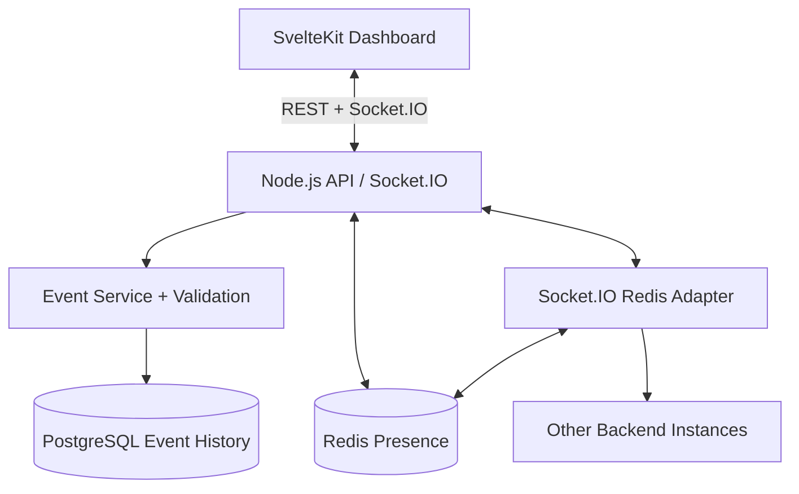

# Pulse — Real-Time Event Feed Platform

A full-stack, event-driven dashboard for publishing and monitoring typed events, tracking online presence, and targeting Socket.IO rooms. Built with SvelteKit, TypeScript, Node.js, Socket.IO, Redis, and PostgreSQL.

## Features
- Live event stream with event type styling, payload inspection, filtering, and pagination.
- Typed event envelope and runtime Zod validation.
- Socket.IO acknowledgements with a five-second client timeout.
- PostgreSQL persistence, indexed history, and idempotency-key uniqueness per user.
- Redis Socket.IO adapter for cross-instance broadcasts and Redis-backed multi-connection presence.
- Room join/leave, REST endpoints, health checks, graceful shutdown, and structured JSON logs.
- Responsive dark dashboard, Docker Compose, and Vitest contract tests.

## Architecture


## Repository layout
```text
apps/backend/src/{config,presence,repositories,rooms,services,sockets,utils}
apps/backend/migrations/       PostgreSQL schema
apps/backend/tests/            Vitest tests
apps/frontend/src/routes/      SvelteKit dashboard
apps/frontend/src/lib/         Socket.IO client
packages/shared/src/           Shared Zod contracts and TypeScript types
docker-compose.yml              PostgreSQL, Redis, API, dashboard
```

## Requirements
- Docker Desktop + Docker Compose (recommended), or Node.js 22+, npm 10+, PostgreSQL 16+, Redis 7+.

## Run with Docker (recommended)
```bash
git clone https://github.com/YOUR_USERNAME/realtime-event-feed-platform.git
cd realtime-event-feed-platform
cp .env.example .env
docker compose up --build
```
Open **http://localhost:5173**. API health: **http://localhost:4000/api/health**. Stop with `Ctrl+C`, or `docker compose down`. Persistent database data remains in the named volume; use `docker compose down -v` to delete it.

## Run locally without Docker
1. Install Node.js 22 and start PostgreSQL and Redis.
2. Create a database and apply `apps/backend/migrations/001_init.sql`.
3. Copy `.env.example` to `.env` and adjust connection strings.
4. Install and run:
```bash
npm install
npm run dev
```
Frontend: http://localhost:5173 · Backend: http://localhost:4000.

## Environment variables
| Variable | Description | Default |
|---|---|---|
| `PORT` | API port | `4000` |
| `FRONTEND_ORIGIN` | Allowed browser origin(s), comma-separated | `http://localhost:5173` |
| `DATABASE_URL` | PostgreSQL connection string | local eventfeed DB |
| `REDIS_URL` | Redis connection string | `redis://localhost:6379` |
| `MAX_HISTORY_SIZE` | Configured history retention target | `500` |
| `PRESENCE_TTL_SECONDS` | Presence socket lease | `90` |
| `VITE_API_URL` | Frontend API URL (reserved for deployments) | `http://localhost:4000` |
| `VITE_SOCKET_URL` | Socket server URL | `http://localhost:4000` |

## REST API
| Method | Endpoint | Description |
|---|---|---|
| GET | `/api/health` | PostgreSQL and Redis health |
| GET | `/api/events?page=1&limit=25&type=MESSAGE_CREATED` | Paginated event history |
| GET | `/api/events/:eventId` | Fetch one event |
| POST | `/api/events` | Validate, persist, and broadcast an event |
| GET | `/api/users/online` | Online users and connection counts |
| GET | `/api/rooms` | Adapter room count diagnostic |
| POST | `/api/rooms/:roomId/join` | Reserved; join through authenticated Socket.IO socket |

Example publish body:
```json
{ "eventType":"MESSAGE_CREATED", "userId":"alice", "payload":{"text":"Hello"}, "roomId":"engineering", "idempotencyKey":"alice-msg-001" }
```

## Socket.IO contract
Client handshake auth: `{ "userId":"alice" }`.

| Direction | Event | Data |
|---|---|---|
| Client → Server | `event:publish` | `PublishEventInput`; acknowledgement `{ok,data}` or `{ok:false,error}` |
| Client → Server | `room:join` | `{roomId}`; acknowledgement |
| Client → Server | `room:leave` | `{roomId}`; acknowledgement |
| Server → Client | `connection:ready` | `{socketId,userId}` |
| Server → Client | `event:new` | Complete versioned event envelope |
| Server → Client | `presence:joined` | `{userId,connections}` |
| Server → Client | `presence:left` | `{userId}` |

Event types: `USER_JOINED`, `USER_LEFT`, `MESSAGE_CREATED`, `SYSTEM_NOTIFICATION`, `TASK_UPDATED`, `CUSTOM_EVENT`. Envelope fields: `eventId` (UUID), `eventType`, ISO-8601 `timestamp`, `userId`, object `payload`, `version: 1`. Optional `roomId` and `idempotencyKey`.

## Tests and build
```bash
npm test
npm run build
npm --workspace @platform/frontend run check
```

## Scalability and guarantees
- Socket.IO Redis adapter distributes room/global broadcasts across backend instances.
- PostgreSQL is the durable source of truth; event rows are inserted before broadcast.
- Acknowledgement confirms server-side validation, persistence, and broadcast initiation—not that every remote browser rendered the event. Socket.IO delivery is at-most-once by default; clients should reload history after reconnect for recovery.
- Idempotency keys are unique per user in PostgreSQL. Repeated keyed submissions are checked before insert and return the original persisted event without broadcasting it again. The database unique index remains the final concurrency guard; simultaneous first-use requests can still race and one may receive a conflict response.
- Presence is connection-aware across instances using Redis socket sets and expiring leases. A production deployment should add periodic lease renewal and a cleanup job for crashed workers.
- The service trims PostgreSQL history to the newest `MAX_HISTORY_SIZE` rows after writes. For high-volume systems, use time/tenant partitioning and scheduled retention instead of a per-write trim query.

## Security and production hardening
This is a portfolio-ready reference implementation, not an audited public SaaS deployment. Before exposing it to the internet, add real authentication/JWT verification, per-user authorization for rooms, distributed publish rate limiting (the included 20 events / 10 seconds limiter is process-local), strict origin configuration, TLS, Redis ACLs, secret management, metrics/tracing, and automated presence lease renewal. The demo handshake accepts a supplied user ID and must not be treated as identity verification.

## License
MIT.
